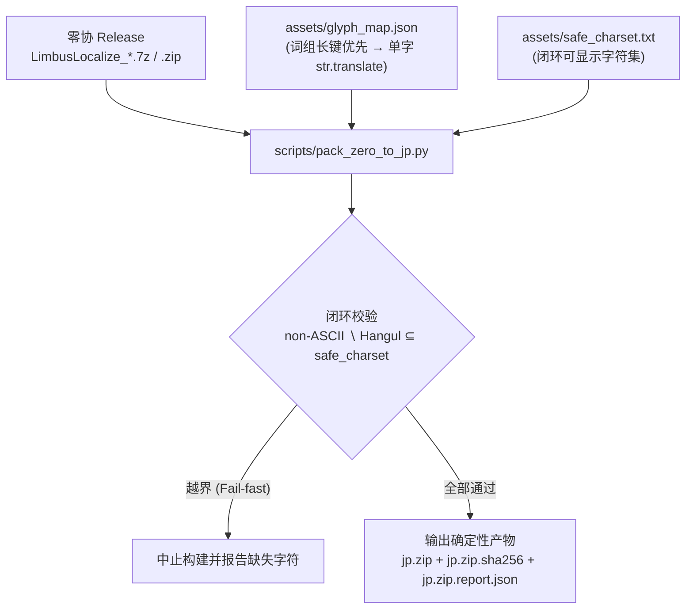

# Limbus-glyph-zero-pack

[](./LICENSE)
[](https://creativecommons.org/licenses/by-nc-sa/4.0/)
[](https://github.com/kermond369-nsis/Limbus-glyph-zero-pack/releases/latest)
[](https://github.com/kermond369-nsis/Limbus-glyph-zero-pack/actions/workflows/build-jp.yml)

自维护字形替换表 + **[都市零协会](https://github.com/LocalizeLimbusCompany/LocalizeLimbusCompany)** 中文译文包 → 《边狱巴士》（*Limbus Company*）安卓日文槽位 `jp.zip` 的确定性、可复现打包流水线。

**核心原则**：
1. **译文信任根以零协为准**：Git 仓库仅托管纯转换脚本与字形映射表，不直接存储游戏本地化正文。
2. **闭环显示校验（Fail-fast）**：所有非 ASCII、非韩文（Hangul）输出字符必须严格落入 `assets/safe_charset.txt`，出现未覆盖生僻字立即阻断构建，拒绝静默缺字或随机乱码顶替。
3. **确定性可复现**：相同输入 + 相同字形表在本地与 GitHub Actions 产出的 `jp.zip` 字节级一致（固定 Zip 时间戳 + SHA-256 校验）。

---

## 上游与致谢（Upstream & Credits）

| 角色 | 项目 / 组织 | 说明 | 协议 |
|---|---|---|---|
| **上游中文译文源** | [LocalizeLimbusCompany（都市零协会汉化组）](https://github.com/LocalizeLimbusCompany/LocalizeLimbusCompany) · [官网](https://www.zeroasso.top) | `LLC_zh-CN` 原文语言包信任根 | [CC BY-NC-SA 4.0](https://creativecommons.org/licenses/by-nc-sa/4.0/) |
| **替换行为参照（iOS）** | [ghcruise/LimbusCompany-IOS-Localization](https://github.com/ghcruise/LimbusCompany-IOS-Localization) | 日文字形替换行为与可显示字符集对照源 | [CC BY-NC-SA 4.0](https://creativecommons.org/licenses/by-nc-sa/4.0/) |
| **替换行为参照（Android）** | [pzwboy/LocalizeLimbusCompanyForAndroid](https://github.com/pzwboy/LocalizeLimbusCompanyForAndroid) | 安卓全树目录结构与社区实证实践参照 | [CC BY-NC-SA 4.0](https://creativecommons.org/licenses/by-nc-sa/4.0/) |
| **配套安卓端** | [kermond369-nsis/Limbus-Auto-CN](https://github.com/kermond369-nsis/Limbus-Auto-CN) | 非 Root 悬浮球一键热替换客户端 | MIT |

---

## 架构概览



输出压缩包内部目录统一映射为游戏安卓客户端路径：
`Android/data/com.ProjectMoon.LimbusCompany/files/Assets/Resources_moved/Localize/jp/**`（文件名前缀为 `JP_`）。

---

## 安卓使用说明

1. **下载产物**：前往本仓库 [Releases](https://github.com/kermond369-nsis/Limbus-glyph-zero-pack/releases/latest) 下载 `jp.zip`（可选用 `jp.zip.sha256` 校验完整性）。
2. **准备游戏语言**：启动《边狱巴士》，将游戏内语言切换为 **`日本語`**，等待官方基础资源包下载完成，进入出现但丁头像的主界面后切回后台（**勿使用小窗模式**）。
3. **覆盖写入目录**：
   - **文件管理器手动覆盖**：在支持写入 `Android/data` 的设备（如允许直接读写该目录的 Android 15+ 系统或系统自带/授权文件管理器）中，将 `jp.zip` 解压并合并到手机内部存储根目录（`/storage/emulated/0/`），确保目标路径为 `Android/data/com.ProjectMoon.LimbusCompany/files/Assets/Resources_moved/Localize/jp/JP_*.json`。
   - **搭配客户端热替换**：也可配合 [Limbus-Auto-CN](https://github.com/kermond369-nsis/Limbus-Auto-CN) 导入 `jp.zip` 后通过悬浮球一键替换。
4. **重启生效**：完全强行停止（杀掉）游戏进程后重新启动。

---

## 资产与脚本说明

| 文件 | 当前版本 / 规模 | 职责 |
|---|---|---|
| `assets/glyph_map.json` | `2026-11-20.full9`<br>1,443 条单字 + 20 条词组（共 1,463 条） | `源字符/词组 → 可显示目标串` 映射表（含极少数控制符清理规则如 `\u200c -> ""`） |
| `assets/safe_charset.txt` | 4,647 个已验证字符 | 闭环校验白名单；除 ASCII 与韩文（Hangul，游戏原生字体必然覆盖）外，所有输出字符必须落入此集合 |
| `assets/font_ok.txt` | Legacy | 旧版 CJK 白名单，仅为兼容历史客户端保留，打包流水线不再依赖 |
| `scripts/pack_zero_to_jp.py` | Python 3 标准库 + `7z`（可选） | 解包 `LLC_zh-CN`、执行词组/单字转换、闭环校验并生成确定性 `jp.zip` 与统计报告 |
| `scripts/audit_glyph_map.py` | Python 3 标准库 | 检查映射表键/值合法性，并支持对零协语料执行 dry-run 覆盖率审计 |
| `scripts/diff_from_reference.py` | Python 3 标准库 | 对照 `ghcruise` 参照包执行增量差分，将新出现的表外字分类为 `KEEP_SAFE` / `REPLACE_SINGLE` / `MANUAL_REVIEW` |

---

## 本地构建与增量维护

### 1. 本地打包

```bash
# 依赖: Python 3.10+（处理 .7z 时需要系统安装 p7zip / 7z）
python3 scripts/pack_zero_to_jp.py \
  --input /path/to/LimbusLocalize.zip \
  --output jp.zip \
  --glyph-map assets/glyph_map.json \
  --safe-charset assets/safe_charset.txt
```

产物：`jp.zip`、`jp.zip.sha256`、`jp.zip.report.json`。

### 2. 表审计与增量差分维护

当零协更新引入新汉字/符号导致 CI 报 `outside safe charset` 时，按以下步骤增量维护：

```bash
# 1) 使用差分脚本对照 ghcruise 最新版 locate 越界字符（可加 --apply 自动合入无歧义单字）
python3 scripts/diff_from_reference.py \
  --llc /path/to/LimbusLocalize.zip \
  --ref /path/to/localize_jp.zip

# 2) 提交前必跑全量审计（必须 warnings=0 且 errors=0）
python3 scripts/audit_glyph_map.py --corpus /path/to/LimbusLocalize.zip
```

> 若出现极少数不在参照包内的字符，可三选一处理：① 补充等价日语/CJK 字形至 `assets/glyph_map.json`；② 添加短词组改写规则；③ 经实机验证可正常渲染后补入 `assets/safe_charset.txt`。更多提取背景见 [docs/glyph-map-rebuild.md](./docs/glyph-map-rebuild.md) 与 [docs/architecture.md](./docs/architecture.md)。

---

## GitHub Actions 自动同步

工作流 [.github/workflows/build-jp.yml](./.github/workflows/build-jp.yml) 会在以下情况运行：
- **定时检查（`schedule`）**：每天 UTC `01:00` 与 `13:00`（北京时间 `09:00` / `21:00`）查询零协最新 Release，仅当上游版本号或本地表/脚本哈希较 `.build-state` 发生变化时才触发构建与 Release 发布。
- **手动触发（`workflow_dispatch`）**：支持传入自定义 `source_url`、`force_rebuild`（强制重建）以及 `publish_release`（是否创建/更新 Release）。

---

## 开源协议与免责声明

本项目采用**代码与数据分离的双层授权**：

| 资产类别 | 适用协议 | 说明 |
|---|---|---|
| **脚本、工作流、文档与字形映射表** | [**MIT License**](./LICENSE) | 本仓库源代码与纯映射规则可自由用于学习、修改与再分发 |
| **Releases 中的 `jp.zip` 打包产物** | [**CC BY-NC-SA 4.0**](https://creativecommons.org/licenses/by-nc-sa/4.0/) | 包含上游零协译文正文，**严禁任何商业用途**，二次分发须保留署名并沿用相同协议 |

完整的上游署名、修改说明与版权声明请参阅 [**THIRD_PARTY_NOTICES.md**](./THIRD_PARTY_NOTICES.md)。

> **免责声明**：本仓库为非官方社区技术工具，仅用于个人客户端本地化替换与字体兼容研究，与 Project Moon 无关。请遵守游戏用户协议与各汉化组发布规范，勿用于商业分发或违规用途。
